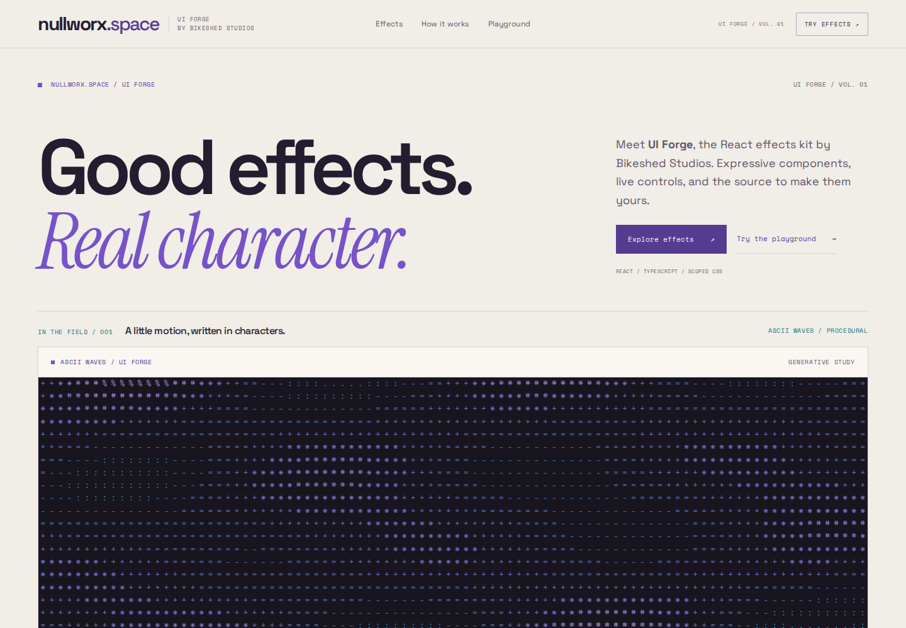

# nullworx.space — UI Forge

[nullworx.space](https://nullworx.space) is the brand. **UI Forge** is the React effects kit, published by **Bikeshed Studios**.

Explore live typography, pointer interactions, procedural ASCII and material studies. The gallery runs as one Next.js application. Magnetic Focus is also independently installable into React apps through the shadcn GitHub registry.



[Live gallery](https://nullworx.space/effects) · [Magnetic Focus](https://nullworx.space/effects/magnetic-focus) · [Installation](docs/MAGNETIC_FOCUS_INSTALL.md) · [Release checks and remaining steps](docs/releases/PUBLIC_DISTRIBUTION_01.md)

## Run the site

Tested with Node **24.20.0** and pnpm **12.15.0**. Dependencies and consumer fixtures have committed lockfiles.

```sh
git clone https://github.com/BikeshedStudios/nullworx.git
cd nullworx
pnpm install --frozen-lockfile
pnpm dev --port 3350
```

Open http://127.0.0.1:3350. For a production build, run `pnpm build` then `pnpm start --port 3350`.

This source includes the deployed polish (`697468992c453c9ca9ed93862f35b3089dc67acb`). The component installation below pins the earlier public registry commit; its three Magnetic Focus files are identical to the deployed polish.

## Install Magnetic Focus

From an initialized React/TypeScript shadcn app with a `components` alias:

```sh
pnpm dlx shadcn@4.23.0 add BikeshedStudios/nullworx/magnetic-focus#4cd0e4b6f8efc95dfd2e4fd2e641c7d194ac378e --yes
curl -fsS https://raw.githubusercontent.com/BikeshedStudios/nullworx/4cd0e4b6f8efc95dfd2e4fd2e641c7d194ac378e/LICENSE -o NULLWORX-LICENSE
```

```tsx
"use client";
import { MagneticFocus } from "@/components/nullworx/magnetic-focus";

export function Action() {
  return <MagneticFocus label="Open field" intensity={0.6} />;
}
```

Requires React and CSS Modules. The registry installs the component, stylesheet and reduced-motion hook together; it needs no Tailwind styles, site fonts or Next.js runtime. Keep the MIT notice with reused source. No npm package is published.

**Public GitHub installation passes in clean Next.js 16.4.3 and Vite 8.3.7 consumers**, using React 19.3.1 and shadcn 4.23.0. Tests cover builds, keyboard/touch/pointer behavior, disabled and paused states, reduced motion and automated accessibility. [Exact commands and limits](docs/MAGNETIC_FOCUS_INSTALL.md).

## Effects and media

The public gallery contains Magnetic Focus, Glyph Morph, Prism Text, ASCII Waves, Ashfall Type, Seam Erosion, Sediment Reveal, Refractive Type and Impossible Material. Magnetic Focus is the only independently verified registry item. The other effects remain gallery/source studies. Digital Wake remains an experimental beta outside the public gallery; its source is retained for local review.

The homepage and ASCII preview use original procedural waves. You can select your own video in the browser; selected files are not uploaded. Restricted footage, masks, motion sidecars and extracted frames are excluded. Video redistribution rights remain unverified, and a clean clone requires no private media to build or display the procedural previews.

Code is [MIT](LICENSE), retaining the original CipherCuttle copyright. Font and dependency notices are in [THIRD_PARTY_NOTICES.md](THIRD_PARTY_NOTICES.md). The included generated Sediment raster has [documented reuse permission and provenance](docs/material-suite/SOURCE_RIGHTS.md). The screenshot above shows only the clean site's original procedural content. See [MEDIA_PROVISIONING.md](MEDIA_PROVISIONING.md) for the separate local-media contract.

## Verify and contribute

```sh
pnpm install --frozen-lockfile
pnpm exec playwright install chromium --with-deps
pnpm verify
pnpm test:distribution
CLEAN_CLONE=1 pnpm test:e2e
pnpm test:launch
pnpm test:distribution:site
```

`test:distribution` installs only from the pinned public GitHub commit, with no local-source fallback. Restricted-media tests explicitly skip in a clean clone. [Release evidence](docs/releases/PUBLIC_DISTRIBUTION_01.md) separates technical readiness from search indexing and lists the final publication steps.

Use [EFFECT_REGISTRY.md](EFFECT_REGISTRY.md) and [ADDING_AN_EFFECT.md](ADDING_AN_EFFECT.md) when contributing.

## Visual Frontier

Refractive Type (Spectral mass / Split signal) and Impossible Material
(Quicksilver / Folded mineral) are owner-approved public effects. Homepage and
gallery cards mount live Canvas2D companions; **Full preview** explicitly loads
the actual approved renderer in the bounded card. The playground provides both
variants, original controls, pause/replay/reset and the complete copyable source.
One shared GPU lease serializes full renderer creation/disposal across cards.

See [installation](docs/visual-frontier/INSTALL.md),
[source and asset rights](docs/visual-frontier/SOURCE_RIGHTS.md) and
[publication contracts](docs/visual-frontier/PROMOTION_01.md). The public sitemap
contains twelve canonical URLs. The private experiment and rejected study remain
outside production. `pnpm test:distribution:frontier` verifies actual clipboard
source in fresh Next/Vite fixtures; `pnpm test:visual-frontier` records browser and
performance evidence (set its receipt/base URL environment variables).
