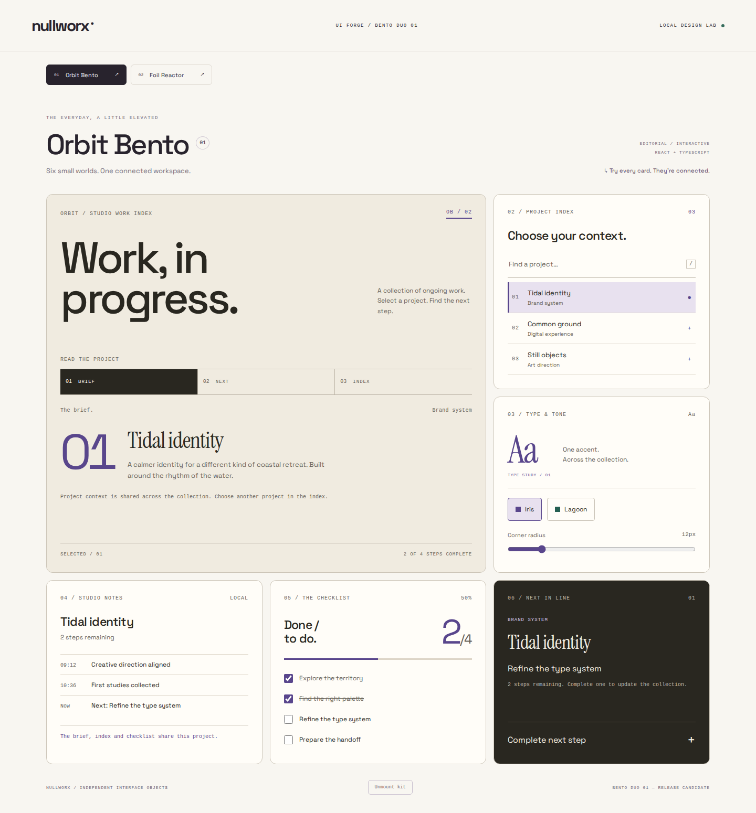
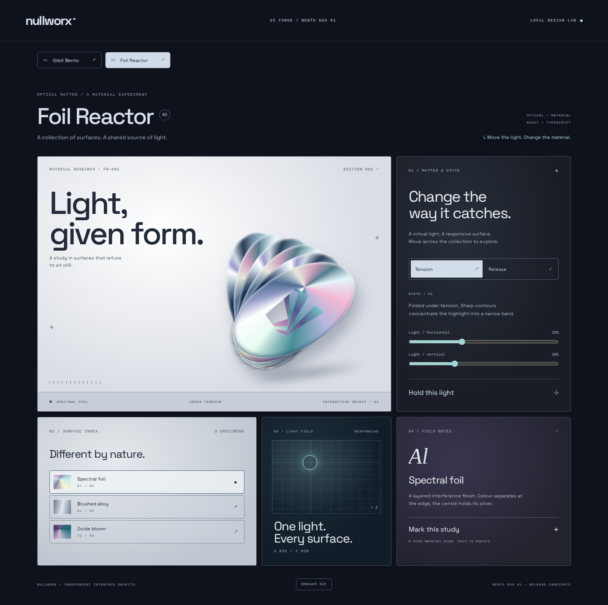

# Nullworx Bento Duo 01

A visual review of two owner-approved React and TypeScript kits: **Orbit Bento 02** and **Foil Reactor**.

Orbit presents a connected project brief, task checklist, search and theme controls through an editorial paper-and-type composition. Foil explores a shared virtual light across material surfaces, with keyboard and touch controls.

| Approved kit | Desktop, 1440px | Mobile, 390px |
| --- | --- | --- |
| Orbit Bento 02 | [Preview](previews/orbit-1440.png) | [Preview](previews/orbit-390.png) |
| Foil Reactor | [Preview](previews/foil-1440.png) | [Preview](previews/foil-390.png) |

This public review contains only approved screenshots and descriptive text. The complete, MIT-licensed customer ZIP is delivered through the separately published [Bento Duo Gumroad product](https://bikeshedstudios.gumroad.com/l/dordxw) at EUR 39, and is not committed to public GitHub. See the canonical [product page](https://nullworx.space/kits/bento-duo) for both kits, purchase terms, and download contents. The customer's copy of the source retains its MIT and applicable font licenses.

The local release candidate passed lint, typecheck, 11 unit tests, production builds, independent Next.js/Vite installations for both kits, and desktop/mobile keyboard, touch and reduced-motion checks. Approved kit files remain unchanged; component pixels match the approved baseline at both preview widths. Browser evidence is Linux headless Chromium, without a physical-device or Safari claim.

The seller reports a successful test checkout/download. Local archive and source hashes were audited; independent comparison of the Gumroad-hosted bytes and a post-download fresh build remain unverified. This review is not the customer ZIP. See [NOTICE.md](NOTICE.md) for image and font attribution.
